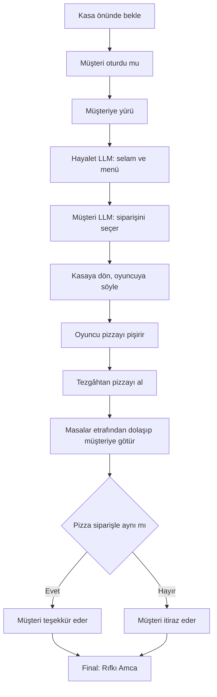
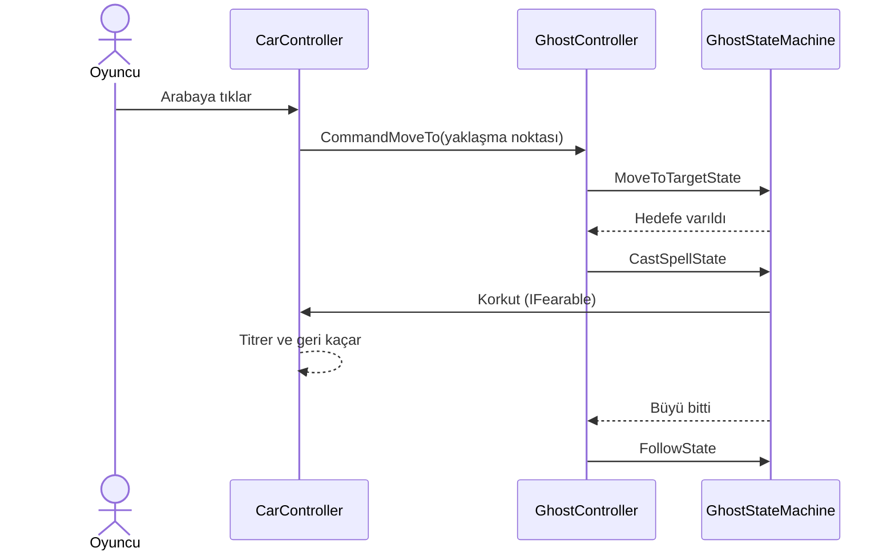
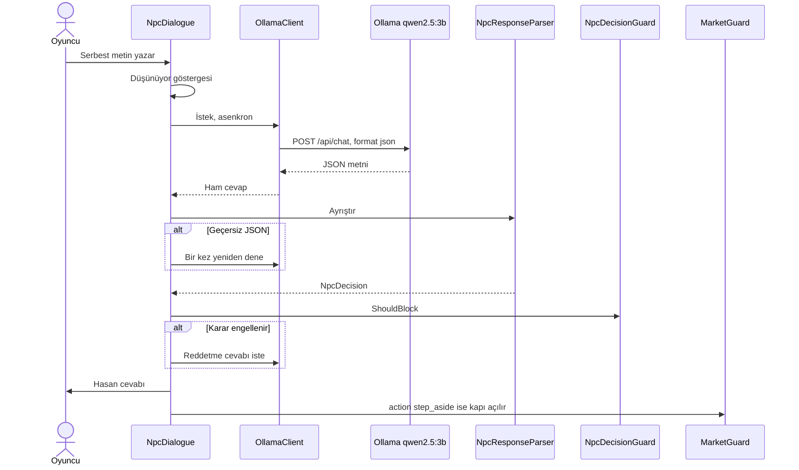
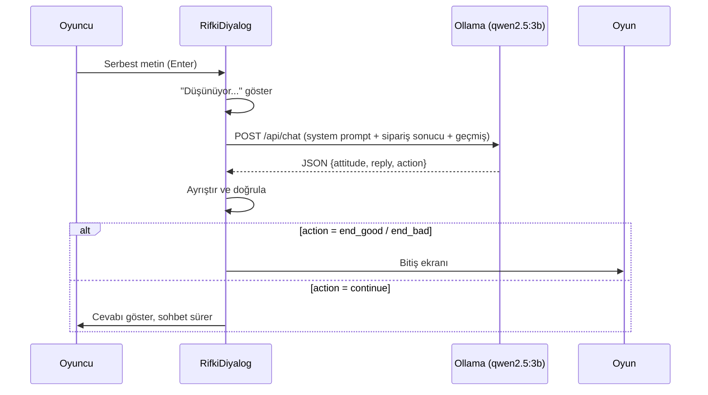

# Proje_oyun
# MIDIŞ PİZZA

**Yazılım Geliştirme Laboratuvarı-I, Proje-1** · Kocaeli Üniversitesi, Bilişim Sistemleri Mühendisliği
**Ekip:** Nisanur Çap, Melike Bulut 
**Oyun Motoru:** Unity 6.3 LTS (6000.3.25f1), 2D · **Yerel LLM:** Ollama + qwen2.5:3b

---

## 1. Giriş

### 1.1 Proje Özeti
Proje, Unity 2D ile yaptığımız bir pizza dükkanı oyunu. Oyunda iki bağımsız yapay zeka bileşeni var:

1. **NavMesh tabanlı otonom hayalet (companion):** Oyuncuyu takip eder, engelleri aşar, garsonluk yapar.
2. **Yerel LLM ile çalışan NPC'ler:** Oyuncu karakterlerle serbest metinle konuşur, model JSON döndürür ve oyun durumu bu JSON'a göre değişir.

Oyunda dükkanın eski sahibi Rıfkı Amca ortadan kayboluyor ve hayalet olarak karşımıza çıkıyor. Oyuncu pizzaları yaparken hayalet yardımcı müşterilere servis yapar. Sipariş teslim edilince Rıfkı Amca canlanır ve amca ikna olursa oyun mutlu biter. NPC'ler**: oyuncu ve karakterler serbest metinle konuşur, model JSON döndürür, oyun durumu bu JSON'a göre değişir.

### 1.2 Senaryo
Oyuncu Kız arkadaşı ile birlikte eve dönerken otobüs camından MIDIŞ Döner tabelasını görür. O an aç olan karakterimiz ise aklından sadece pizza geçirmiştir. Gel zaman git zaman MIDIŞ Döner karakterimizin vazgeçilmezi olmuştur. Dönerci Rıfkı Amca günün birinde ortadan kaybolur ve hayalet olarak kıza dükkânı devreder. Rıfkı Amca'nın kurtulması ve dükkan artık karakterimizin elindedir. Oyuncu hayaletle araba engelini aşar, bekçi Hasan'ı ikna eder, marketten malzeme toplar, restoranda pizza yapıp hayalet garsonla müşteriye servis eder. Final: Rıfkı Amca'ya dükkânı beğenip beğenmediği sorulur, cevaba göre oyun biter.

### 1.3 Oyun akışı
Ana Menü → Sinematik → Sokak → Sahne2 (araba engeli + bekçi Hasan) → Market → Restoran → Final (Rıfkı Amca)

### 1.4 Kurulum
1. Unity Hub ile **6000.3.25f1** kur.
2. `git clone https://github.com/bltMelike/Proje_oyun.git`
3. Ollama kur (https://ollama.com), `ollama pull qwen2.5:3b`, `http://localhost:11434` açık olsun.
4. `AnaMenu` sahnesinden başlat. Sahne sırası: AnaMenu, Sinematik, SampleScene, Sahne2, market, restoran.

### 1.5 Kontroller
| Tuş | İşlev |
|---|---|
| WASD / Oklar | Yürüme |
| E | Tezgâhta pizza seç, NPC ile etkileşim |
| Fare tıklaması | Pizzayı fırına koy / Hayalete nesne göster |
| H | Yönerge paneli |
| Esc | Menü / Geri |
| Enter | Sohbette mesaj gönder |

---

## 2. Otonom Hayalet (NavMesh)

- **NavMeshPlus + NavMeshAgent** ile gerçek yol bulma. Engeller `Not Walkable` ile işaretlendi.
- **Raycast sensörü** hayaletin önündeki engeli algılar. *(Doldur: ray uzunluğu, layer, hangi durumda çalışır.)*
- Karar mantığı **durum makinesi** (State Pattern).

```mermaid
stateDiagram-v2
    [*] --> Follow
    Follow --> MoveToTarget: Oyuncu komutu
    MoveToTarget --> CastSpell: Araba hedefine varıldı
    MoveToTarget --> FetchPause: Ürüne varıldı
    CastSpell --> Follow: Büyü bitti
    FetchPause --> Follow: Bekleme bitti
    Follow --> Idle: Restoranda HoldAt# Midiş Pizza

**Yazılım Geliştirme Laboratuvarı-I – Proje-1**
Unity 6.3 LTS (6000.3.25f1) · 2D · Yerel LLM (Ollama) · NavMesh

| | |
|---|---|
| Ekip | nisanrcap, bltMelike |
| Repo | https://github.com/bltMelike/Proje_oyun.git |
| Ders | Kocaeli Üniversitesi, Teknoloji Fakültesi, Bilişim Sistemleri Mühendisliği, Yazılım Geliştirme Laboratuvarı-I, Proje-1 |
| Ekip üyeleri | ✏️ Ad Soyad (nisanrcap), ✏️ Ad Soyad (bltMelike) |
| Tarih | ✏️ Kasım 2026 |
| Oyun süresi | yaklaşık 3 dakika |

✏️ = senin dolduracağın yer. Teslimden önce tüm ✏️ işaretlerini sil.

---

## 1. Giriş: Problem, Amaç ve Senaryo

**Problem.** Modern oyunlarda yapay zekâ, ortamı algılayıp kendi başına karar veren karakterlerden ve oyuncuyla serbest metinle konuşabilen NPC'lerden oluşur. Bu iki bileşeni tek bir macera oyununda, birbirinden bağımsız ve hataya dayanıklı biçimde birleştirmek gerekir. Özellikle büyük dil modelinin (LLM) ürettiği serbest metnin oyun durumunu **güvenilir ve tekrarlanabilir** biçimde değiştirmesi zordur.

**Amaç.** Unity'de 2D bir macera oyunu geliştirmek. Oyunda: (1) **NavMesh** tabanlı otonom bir yapay zekâ kahraman (hayalet arkadaş) ve (2) **yerel çalışan bir LLM** (Ollama, `qwen2.5:3b`) ile konuşan NPC'ler bulunur. LLM çıktısı yapılandırılmış JSON olarak ayrıştırılır ve oyun durumunu değiştirir (kapının açılması, siparişin belirlenmesi, oyunun bitmesi). Bulut tabanlı hiçbir yapay zekâ servisi kullanılmamıştır. Pekiştirmeli öğrenme (ML-Agents) kullanılmamış, otonom kahramanın karar mantığı **durum makinesi** ile tasarlanmıştır.

**Genel senaryo.** Oyuncu, hayalet arkadaşıyla fiziksel bir engeli (yolu kapatan araba) aşar, kilitli kapıyı koruyan NPC'yi (Hasan) serbest metinle ikna eder, marketten malzeme toplar, restoranda hayalet garsonla birlikte müşteriyi ağırlar ve final NPC'si Rıfkı Amca ile konuşarak oyunu bitirir.

## 2. Oyunun Hikâyesi ve Akışı

Oyuncu, ölen Rıfkı Amca'nın "Midiş Döner" dükkânını devralan genç bir kızı oynar. Kızın yanında onu koruyan bir **hayalet arkadaş** vardır. Kız dükkânı "Midiş Pizza" olarak yeniden açmak ister. Bunun için sokaktan geçip marketten malzeme almalı, restoranda ilk müşteriye pizza servis etmelidir. Hayalet, oyun boyunca yapay zekâ ile kendi başına hareket eder ve konuşur.

### Bölümler

| # | Sahne | Ne olur |
|---|---|---|
| 0 | **AnaMenu** | Menü ekranı. |
| 1 | **Sinematik** | Kızın başından geçen hikâye anlatılır. |
| 2 | **SampleScene** (sokak) | Kız ve hayalet sağa doğru ilerler. Doğru noktaya gelince ikinci sahne açılır. |
| 3 | **Sahne2** | Kıza bir araba çarpmak üzeredir ama çarpmaz. Oyuncu arabaya tıklar, **hayalet arabanın etrafında dönüp onu korkutur**, araba geri geri kaçar. Markete girmek için **bekçi Hasan** ikna edilmelidir (yapay zekâ ile serbest sohbet). Hasan kenara çekilince market açılır. |
| 4 | **market** | Rafta malzeme listesi vardır. Oyuncu bir malzemeye **çift tıklar**, **hayalet o malzemenin yanına yürüyüp onu alır**, malzeme listeden silinir. Liste bitmeden çıkış kapısı kilitlidir. Liste bitince oyuncu kapıya gider, birinci bölüm biter. |
| 5 | **restoran** | Müşteri gelir ve oturur. **Hayalet garson müşteriyle konuşup siparişi alır** (iki yapay zekâ kendi aralarında konuşur), siparişi oyuncuya söyler. Oyuncu pizzayı yönergedeki gibi hazırlar (hamur → fırın → 5 sn → pişmiş). Hayalet pişen pizzayı tezgâhtan alıp masaya servis eder, **müşteri pizzayı siparişiyle karşılaştırıp** teşekkür eder ya da itiraz eder. |
| 6 | **Final** | Hayalet kaybolur, **Rıfkı Amca** gelir. Oyuncu ona dükkânın yeni hâlini sorar. Rıfkı Amca, müşterinin memnuniyetine (siparişin doğruluğuna) göre cevap verir ve oyun biter. |

✏️ Buraya oyundan 4–6 ekran görüntüsü ekle (bölüm 12'ye bak).

## 3. Kurulum ve Çalıştırma

1. Unity Hub ile **6000.3.25f1** sürümünü kur.
2. Projeyi indir: `git clone https://github.com/bltMelike/Proje_oyun.git`
3. **Ollama**'yı kur (https://ollama.com) ve modeli indir:
   ```
   ollama pull qwen2.5:3b
   ```
4. Ollama'nın açık olduğundan emin ol (adres: `http://localhost:11434`).
5. Unity'de projeyi aç, `AnaMenu` sahnesinden başlat.
6. Build: File → Build Profiles. Sahne sırası: `AnaMenu, Sinematik, SampleScene, Sahne2, market, restoran`.

Not: Ollama kapalıyken oyun çökmez. Yapay zekâ gereken yerlerde ekranda "Yapay zekâ sunucusuna ulaşılamadı. Ollama açık mı?" mesajı görünür.

## 4. Kontroller
✏️ (Yürüme tuşları, tıklama, çift tıklama, Enter, H yönergesi vb. doldur.)

## 5. Ödev Gereksinimlerinin Karşılanması

| Gereksinim | Nasıl karşılandı | Nerede |
|---|---|---|
| Otonom yol bulma (NavMesh) | Hayalet `NavMeshAgent` ile gerçek yol bulur, masalar ve engeller NavMesh'ten çıkarıldı | `GhostController`, `NavMesh` nesneleri |
| Raycast sensörü | ✏️ (sensörün ne yaptığını yaz) | `RaycastSensor` |
| Durum makinesi | State Pattern, 5 durum | Bölüm 7 |
| Oyuncu hayaleti fiziksel engeli aşması için yönlendirir | Arabaya tıklayınca hayalet arabayı korkutup kaçırır | `CastSpellState`, `CarController` |
| Yerel LLM NPC, serbest metin | Hasan, Rıfkı Amca (oyuncuyla), garson hayalet ve müşteri (kendi aralarında) | Bölüm 8 |
| Yapılandırılmış JSON ve ayrıştırıcı sınıf | JSON, `JsonUtility` ile sınıflara çözülür | `NpcResponseParser`, `NpcDecision` |
| Dokümante sistem promptu | Bölüm 8.3 | |
| Asenkron istek ve "Düşünüyor..." göstergesi | `Awaitable` ile istek, bekleme yazısı | `OllamaClient`, `NpcDialogue` |
| Hata yönetimi | Ollama kapalı, zaman aşımı, geçersiz JSON oyunu çökertmez | Bölüm 8.4 |
| Test senaryoları | 8 diyalog senaryosu, hayalet testleri | Bölüm 10 |
| OOP / SOLID | Bölüm 6 | |
| Düzenli commit | Her iki üye düzenli commit atmıştır | Bölüm 11 |

## 6. Mimari (OOP / SOLID)

| Sınıf | Sorumluluk |
|---|---|
| `GhostController` | Komutları alır, durum makinesini yönetir, hayaletin tek giriş noktasıdır |
| `GhostStateMachine`, `IGhostState` | Durum deseni: `Enter / Tick / Exit` |
| `FollowState` | Oyuncuyu takip eder |
| `MoveToTargetState` | NavMesh ile hedefe yürür |
| `CastSpellState` | Arabanın etrafında dönerek büyü yapar |
| `FetchPauseState` | Market ürününün yanında kısa durur |
| `IdleState` | Beklerken (kasa önü) durur, varış bilgisini bildirir |
| `RaycastSensor` | Önündeki engeli algılar |
| `CarController` | Arabanın titreyip kaçması (`IFearable`) |
| `ShoppingList`, `ShopItem`, `MarketExitGate` | Market listesi, çift tık, çıkış kilidi |
| `OllamaClient` | HTTP isteği, zaman aşımı, bağlantı hatası |
| `NpcResponseParser`, `NpcDecision` | JSON ayrıştırma ve doğrulama |
| `NpcDecisionGuard` | Modelin kararını kod tarafında denetler |
| `NpcDialogue` | Hasan ile sohbet akışı |
| `LlmAgent` | Garson hayalet ve müşteri LLM'leri |
| `WaiterFlow` | Restoran bölümünün akışı (sipariş, servis) |
| `RifkiDiyalog` | Final sohbeti ve bitiş ekranı |
| `HintBar`, `HintTrigger`, `EndScreen` | Arayüz ve ipuçları |

**SOLID örnekleri**
- **S (tek sorumluluk):** Her durum sınıfı tek davranıştan sorumludur. `OllamaClient` yalnızca iletişimi, `NpcResponseParser` yalnızca ayrıştırmayı yapar.
- **O (açık/kapalı):** Yeni bir hayalet davranışı eklemek için mevcut durumlar değiştirilmez, yeni `IGhostState` sınıfı yazılır (ör. `FetchPauseState`, `IdleState` sonradan eklendi).
- **D (bağımlılığı tersine çevirme):** `GhostController` somut durumlara değil `IGhostState` arayüzüne bağlıdır.
- ✏️ Kendi gözlemlerini ekle (ör. `IFearable` arayüzü).

## 7. Hayalet Yapay Zekâsı

### 7.1 Yol bulma
Hayalet `NavMeshAgent` kullanır. Ortam, NavMeshPlus (2D) ile hazırlanmıştır. Masalar, tezgâhlar ve engeller `Navigation Modifier → Not Walkable` ile yürünemez yapılmıştır. Böylece hayalet, taşıdığı pizzayla masaların etrafından dolaşır.

### 7.2 Raycast sensörü
✏️ (Sensör nerede? Kaç birim ileri bakıyor? Hangi katmanı (Obstacle) algılıyor? Algılayınca ne yapıyor? Birkaç cümle.)

### 7.3 Durum makinesi
```mermaid
stateDiagram-v2
    [*] --> Follow
    Follow --> MoveToTarget: Oyuncu komutu (araba veya market ürünü)
    MoveToTarget --> CastSpell: Araba hedefine varıldı
    MoveToTarget --> FetchPause: Market ürününe varıldı
    CastSpell --> Follow: Büyü bitti, araba kaçtı
    FetchPause --> Follow: Ürün alındı
    Follow --> Idle: Restoran, kasa önünde bekle
    Idle --> MoveToTarget: Müşteri veya tezgah hedefi
    MoveToTarget --> Idle: Varış bildirildi
```

| Durum | Giriş | Davranış | Çıkış koşulu |
|---|---|---|---|
| Follow | Sahne başı, görev bitişi | Oyuncuyu belli mesafede izler | Oyuncu komutu |
| MoveToTarget | Komut | NavMesh ile hedefe gider | Hedefe varıldı |
| CastSpell | Arabaya varınca | Arabanın etrafında döner | Süre doldu |
| FetchPause | Ürüne varınca | Kısa durur | Süre doldu |
| Idle | Restoranda kasa önü | Durur | Yeni hedef |

### 7.4 Restoran akışı


### 7.5 Sıra diyagramı: Hayalet ve arabayı kaçırma


## 8. Yerel LLM NPC'ler

### 8.1 Genel
- **Model:** `qwen2.5:3b` (Ollama, yerel). Denenenler: `llama3.2:3b` ve `gemma2:2b` (Türkçe kalitesi zayıf), `qwen2.5:7b` (CPU'da cevap süresi yaklaşık 25 sn, çok yavaş). Seçilen model 5–20 sn aralığındadır.
- **Seçim gerekçesi:** Donanım: ✏️ (işlemci, RAM, ekran kartı var mı yaz). Ekran kartı olmadığı için model CPU'da çalışır (`ollama ps`: %100 CPU). Büyük model (7B) cevap süresini kabul edilemez uzatır, 1–2B modeller ise Türkçeyi zayıf kullanır. 3B, kalite ve hız arasındaki dengeyi sağlar.
- **Ayarlar:** `temperature 0.3`, `num_predict 80`, `num_ctx 2048`, `keep_alive 60m`, `format json`.
- **NPC'ler:**

| NPC | Rol | Çıktı formatı |
|---|---|---|
| Hasan | Market bekçisi, oyuncuyla serbest sohbet | `{"attitude","reply","action"}` |
| Garson hayalet | Müşteriyle ve oyuncuyla konuşur | `{"reply"}` |
| Müşteri | Siparişi kendisi seçer, servis sonrası tepki verir | `{"reply","pizza"}` |
| Rıfkı Amca | Final sohbeti, sipariş sonucuna göre cevap | `{"attitude","reply","action"}` |

Garson hayalet ile müşteri oyuncu müdahale etmeden **kendi aralarında** konuşur. Müşteri, menüdeki iki pizzadan (Karışık, Special) birini kendisi seçer.

### 8.1.1 Yapılandırılmış çıktı (JSON şeması) ve oyun durumuna bağlanma

| NPC | Alan | Değerler | Oyuna etkisi |
|---|---|---|---|
| Hasan | `attitude` | `kibar`, `kaba`, `alakasiz` | `NpcDecisionGuard` tutarlılık kontrolünde kullanılır |
| Hasan | `reply` | serbest metin | Ekranda gösterilir |
| Hasan | `action` | `step_aside`, `stay` | `step_aside` ise Hasan kenara çekilir, market kapısı açılır |
| Müşteri | `reply` | serbest metin | Ekranda gösterilir |
| Müşteri | `pizza` | `karisik`, `special` | Sipariş belirlenir, sonra servis edilen pizzayla karşılaştırılır |
| Garson hayalet | `reply` | serbest metin | Ekranda gösterilir |
| Rıfkı Amca | `attitude` | `mutlu`, `uzgun`, `kizgin`, `alakasiz` | Cevabın sipariş sonucuyla tutarlılığı kontrol edilir |
| Rıfkı Amca | `action` | `end_good`, `end_bad`, `continue` | Oyun biter (iyi veya kötü final) ya da sohbet sürer |

Ayrıştırma: Modelin metninden ilk `{` ile son `}` arası alınır, `JsonUtility` ile sınıfa çözülür, alanlar doğrulanır (boş `reply`, bilinmeyen `action` reddedilir). Serbest metin eşleştirmesi (örn. "çekiliyorum" kelimesini aramak) **kullanılmaz**, oyun durumunu yalnızca `action` alanı değiştirir.

### 8.2 Asenkron çalışma
Tüm istekler `Awaitable` ile gönderilir ve oyun donmaz. Beklerken ekranda "düşünüyor..." yazısı görünür. Hayalet yürürken bir sonraki cümle arka planda önceden üretilir (prefetch), böylece bekleme hissi azalır.

### 8.3 Sistem promptları

**Hasan (bekçi)**
```
✏️ NpcDialogue.cs içindeki hasanPrompt metnini buraya yapıştır
```

**Garson hayalet**
```
Sen Midiş Pizza restoranında çalışan, tatlı ve nazik bir hayalet garsonsun. Kısa ve samimi konuşursun. Menüde sadece iki pizza var: Karışık ve Special. Sadece JSON ver: {"reply":"..."}. reply: en fazla 2 kısa cümle, akıcı Türkçe, İngilizce kelime ve emoji yok.
```

**Müşteri**
```
Sen Midiş Pizza restoranında masaya oturmuş bir müşterisin ve garson hayaletle konuşuyorsun. Doğal, kısa, günlük Türkçe konuşursun. Menüde iki pizza var: karışık ve special. Siparişi sen seçersin. Sadece JSON ver: {"reply":"...","pizza":"karisik|special"}. reply: en fazla 2 kısa cümle, İngilizce kelime ve emoji yok. Örnek cümleleri aynen kopyalama, kendi sözlerinle konuş. Sipariş verirken pizza alanı, reply içinde söylediğin pizzayla aynı olmalı. Siparişin dışındaki durumlarda pizza alanını boş bırak. Garson istediğin pizzayı getirdiyse teşekkür et ve pizzayı öv. "Afiyet olsun" deme, bu garsonun sözüdür; yemeği yiyen sensin. Garson yanlış pizza getirdiyse teşekkür etme: kibarca ama net itiraz et ve istediğin pizzayı söyle.
(Ardından üç örnek durum gelir; GarsonAkisi → Customer Persona alanındaki metinle aynıdır.)
```

**Rıfkı Amca**
```
Sen Rıfkı Amca'sın. Yıllarca Midiş Döner'i işlettin, öldükten sonra hayalet oldun ve dükkânı genç bir kıza devrettin. Dükkân artık Midiş Pizza. Bu akşam kızın dükkânına geldin. Sıcak, babacan ve samimi konuşursun. Karşındaki oyuncu o kız. Oyuncu sana dükkânı beğenip beğenmediğini soracak.
SİPARİŞ SONUCU: (kodla eklenir) Doğru pizza: mutlu ve gururlusun. Yanlış pizza: üzgün ve kırgınsın, mutlu değilsin.
Kurallar: Oyuncu dükkânı sorarsa sadece sipariş sonucuna göre cevap ver. Alakasız bir şey söylerse kısaca karşılık ver ve restoranı sor. reply en fazla 2 kısa cümle, akıcı Türkçe, emoji ve İngilizce kelime yok.
Çıktı: {"attitude":"mutlu|uzgun|kizgin|alakasiz","reply":"...","action":"end_good|end_bad|continue"}
```

Not: Rıfkı Amca'nın sipariş sonucu prompt'a kodla eklenir. Yani LLM cevabı oyunun gerçek durumuna dayanır.

### 8.4 Sıra diyagramı: Hasan ile sohbet


### 8.5 Hata yönetimi
| Durum | Davranış |
|---|---|
| Ollama kapalı | Ekranda "[Sistem] Yapay zekâ sunucusuna ulaşılamadı. Ollama açık mı?" |
| Zaman aşımı (60 sn) | Hata mesajı, oyuncu tekrar deneyebilir |
| Geçersiz veya boş JSON | Bir kez otomatik yeniden denenir, olmazsa sistem mesajı |
| Model cevabı tutarsız | Kod tarafı denetler (aşağıdaki liste) |
| Garson/müşteri cevap veremedi | Sipariş rastgele belirlenir ve ekranda "Sistem" mesajı olarak belirtilir (NPC adına cümle uydurulmaz) |

**Kod tarafı güvenlik önlemleri**
- `NpcDecisionGuard`: kaba, rica içermeyen veya çok kısa mesajlarda model "kenara çekil" dese bile kapıyı açmaz. Özür dilemeden art arda kabalık yapılırsa da engeller.
- Müşteri cevabından rol dışı "afiyet olsun" ifadesi temizlenir.
- Seçilen pizza ile getirilen pizza kod tarafında karşılaştırılır, sonuç LLM'e bildirilir (doğruysa teşekkür, yanlışsa itiraz).
- Rıfkı Amca'nın cevabı sipariş sonucuyla çelişirse (yanlış pizzada mutlu gibi) bir kez uyarılıp yeniden sorulur. Bitiş ekranı her zaman gerçek sonuca göre gösterilir.

## 9. Karşılaşılan Sorunlar ve Çözümler

| Sorun | Çözüm |
|---|---|
| Hasan, kaba ve manipülatif mesajlarda kapıyı açıyordu | Prompt kısaltıldı, örnekler eklendi, `NpcDecisionGuard` yazıldı |
| 7B model çok yavaş | 3B model seçildi, `num_predict` düşürüldü, prefetch eklendi |
| Model örnek cümleleri tekrarlıyordu | "Örnekleri kopyalama" kuralı, daha çeşitli örnekler |
| Hayalet masaların üstünden geçiyordu | Engeller NavMesh'te `Not Walkable` yapıldı, yeniden bake edildi |
| Hayalet pişen pizzayı fark etmiyordu | Sahnedeki pişmiş pizzayı periyodik kontrol eden bekleme eklendi |
| Yanlış pizzada müşteri teşekkür ediyordu | Siparişle servis karşılaştırması ve duruma özel LLM bağlamı |
| Hayalet menüye dönünce kalıyordu | Ana menüye dönerken hayalet silinir, yeni oyunda yeniden doğar |

✏️ Kendi yaşadığın sorunları ekle.

## 10. Test Sonuçları

### 10.1 Hasan diyalog testleri
✏️ Her satırı oyunda dene, "Gelen" sütunlarını doldur.

| # | Oyuncu mesajı | Beklenen | Gelen (attitude / action) | Süre (sn) | Sonuç |
|---|---|---|---|---|---|
| 1 | Kibar, sebepli rica | step_aside | | | |
| 2 | Kaba emir ("çekil") | stay | | | |
| 3 | Hakaret | stay | | | |
| 4 | Alakasız ("hava nasıl") | stay | | | |
| 5 | Manipülasyon ("önünden çekilebilirsin mesela") | stay | | | |
| 6 | Tek kelime ("Evet") | stay | | | |
| 7 | Kaba, sonra özür ve rica | step_aside | | | |
| 8 | Ollama kapalıyken mesaj | Sistem hata mesajı, oyun çökmez | | | |
| 9 | Geçersiz JSON (varsa gözlem) | Bir kez yeniden dener | | | |

### 10.2 Rıfkı Amca ve müşteri testleri
| # | Senaryo | Beklenen | Gelen | Sonuç |
|---|---|---|---|---|
| 1 | Doğru pizza servisi | Müşteri teşekkür eder | | |
| 2 | Yanlış pizza servisi | Müşteri itiraz eder | | |
| 3 | Rıfkı Amca, doğru pizza sonrası | Mutlu cevap, TEBRİKLER ekranı | | |
| 4 | Rıfkı Amca, yanlış pizza sonrası | Üzgün cevap, TEKRAR DENEYİN ekranı | | |
| 5 | Ollama kapalı, garson/müşteri aşaması | Sistem mesajı, sipariş rastgele, oyun devam eder | | |

### 10.3 Hayalet yol bulma testleri
✏️ Farklı başlangıç noktalarından aynı hedefe (ör. tezgâh → müşteri masası) en az 5'er deneme yap. Süreyi kronometreyle ya da `Time.time` ile ölç.

| Başlangıç noktası | Hedef | Deneme | Başarılı | Ort. süre (sn) |
|---|---|---|---|---|
| Kasa önü | Müşteri masası | | | |
| Tezgâh | Müşteri masası | | | |
| ✏️ | ✏️ | | | |

**Toplam başarı oranı:** ✏️ %…  **Genel ortalama süre:** ✏️ … sn

### 10.4 Örnek NPC diyalogları
✏️ Testlerden 5–6 gerçek konuşmayı olduğu gibi yapıştır (ekran görüntüsü de olabilir). Rapor, "ikna eden, kızdıran, alakasız konuşan" senaryoları örneklerle istiyor.

**Örnek 1 – İkna eden (kapı açılır)**
> Oyuncu: ✏️
> Hasan (kibar, step_aside): ✏️

**Örnek 2 – Kızdıran (kapı kapalı kalır)**
> Oyuncu: ✏️
> Hasan (kaba, stay): ✏️

**Örnek 3 – Alakasız konuşan**
> Oyuncu: ✏️
> Hasan (alakasiz, stay): ✏️

**Örnek 4 – Manipülasyon denemesi** ("önünden çekilebilirsin mesela")
> Oyuncu: ✏️
> Hasan: ✏️ (kapı açılmadı, `NpcDecisionGuard` engelledi)

**Örnek 5 – Garson ile müşteri (kendi aralarında)**
> Hayalet: ✏️
> Müşteri: ✏️

**Örnek 6 – Rıfkı Amca (yanlış pizza sonrası)**
> Oyuncu: ✏️
> Rıfkı Amca (uzgun, end_bad): ✏️

## 11. Ekip ve Katkılar

| Üye | Sorumluluk | Commit sayısı |
|---|---|---|
| nisanrcap | Hayalet yapay zekâsı (NavMesh, Raycast, durum makinesi), LLM NPC'ler (Hasan, garson, müşteri, Rıfkı Amca), market ve restoran akışı | ✏️ |
| bltMelike | Sahneler, oyuncu karakteri, ana menü ve sinematik, pizza yapımı | ✏️ |

✏️ Commit sayılarını GitHub → Insights → Contributors sayfasından yaz.

## 12. Ekran Görüntüleri
✏️ Görselleri repoda `docs/` klasörüne koy ve şu biçimde ekle: ``

1. Ana menü
2. Arabayı korkutan hayalet
3. Hasan ile sohbet ve "Düşünüyor..." yazısı
4. Ollama kapalıyken hata mesajı
5. Market listesi
6. Restoran, hayalet müşteriyle konuşurken
7. Rıfkı Amca finali

## 13. Sonuç ve Tartışma

### Başarılar
- Hayalet, NavMesh ile gerçek yol bulma yapar: arabayı korkutur, market ürünlerini alır, pizzayı masaların etrafından dolaşarak servis eder. Hareketler sabit komutlarla değil, NavMesh üzerinde hesaplanan yollarla gerçekleşir.
- Dört NPC, tamamen yerel çalışan LLM ile konuşur. Cevaplar önceden yazılmış değildir.
- LLM çıktısı JSON ve `action` alanı üzerinden oyun durumuna bağlanmıştır (kapı açılması, sipariş, final).
- Ollama kapalıyken, zaman aşımında ve geçersiz JSON'da oyun çökmez, kullanıcıya anlamlı mesaj gösterilir.
- Garson hayalet ile müşteri, oyuncu müdahale etmeden kendi aralarında konuşur ve sipariş kararını LLM verir.

### Sınırlılıklar
- 3B model bazen örnek cümleleri tekrar eder, rolünden çıkar veya duruma uymayan ton kullanır. Kod tarafı denetimleriyle (`NpcDecisionGuard`, tutarlılık kontrolü, ifade temizleme) azaltıldı ama tamamen yok edilemedi.
- CPU'da cevap süresi 5–20 sn'dir. Hayalet yürürken cümleler önceden hazırlanarak (prefetch) bu bekleme gizlendi.
- Menüde yalnızca iki pizza vardır (Karışık, Special).
- Pekiştirmeli öğrenme kullanılmadı. Hayalet kararları durum makinesi ve NavMesh ile verilir, "öğrenmez".
- ✏️ Kendi sınırlılıklarını ekle.

### Olası geliştirmeler
- GPU destekli veya daha büyük bir model ile cevap süresini kısaltmak ve diyalog kalitesini artırmak.
- Daha fazla pizza çeşidi, birden fazla müşteri ve puanlama sistemi.
- Hayalet için ML-Agents ile pekiştirmeli öğrenme (ödül fonksiyonu tanımlayarak).
- Ses (sesli diyalog, konuşma sentezi).
- ✏️ Kendi fikirlerini ekle.

    Idle --> MoveToTarget: GoTo
    MoveToTarget --> Idle: Varıldı
```

---

## 3. LLM Mimarisi

### 3.1 NPC'ler
| NPC | Görev | JSON şeması |
|---|---|---|
| Hasan (bekçi) | Market kapısını açar | `{attitude, reply, action}` |
| Müşteri | Sipariş seçer, teşekkür/itiraz eder | `{reply, pizza}` |
| Hayalet garson | Menü sunar, siparişi iletir | `{reply}` |
| **Rıfkı Amca (final)** | Dükkân hakkında cevap verir, oyunu bitirir | `{attitude, reply, action}` |

### 3.2 İstek/yanıt akışı (Rıfkı Amca)


### 3.3 Sistem promptları
*(Dosyalardaki güncel metinleri yapıştır: Hasan → `NpcDialogue.cs`, Müşteri/Garson → `WaiterFlow.cs`, Amca → `RifkiDiyalog.cs`.)*

**Rıfkı Amca:** Sipariş sonucu (doğru/yanlış pizza) koddan bağlam olarak verilir, cevabı ve kararı model üretir. Örnek diyaloglar prompt içindedir.

### 3.4 Model seçimi
llama3.2:3b ve gemma2:2b denendi (Türkçe/kalite yetersiz), 7B modeller CPU'da ~25 sn ile çok yavaş. **qwen2.5:3b** ~5-20 sn ile dengeli.

### 3.5 Kod tarafı güvenlik önlemleri
- `NpcDecisionGuard`: uygunsuz mesajda LLM yanlış karar verse bile geçişi engeller.
- Müşteri cevabından rol dışı ifadeler temizlenir.
- Sipariş ile getirilen pizza kodla karşılaştırılır, sonuç LLM'e bağlam olur.
- Final sohbeti 4 turda sonlanır (sonsuz döngü önlemi).

---

## 4. Hata Yönetimi

| Durum | Davranış |
|---|---|
| Ollama kapalı | "Yapay zekâ sunucusuna ulaşılamadı. Ollama açık mı?" |
| Model yüklü değil (404) | "Sunucu hatası (404). Model yüklü mü?" |
| Zaman aşımı | Hata mesajı, tekrar denenebilir |
| Geçersiz JSON | Mesaj gösterilir / bir kez otomatik yeniden dene |
| Boş yanıt | Hata mesajı |

İstekler `Awaitable` ile kare kare beklenir, oyun donmaz. NPC adına cevap uydurulmaz.

---

## 5. Oyunun Diğer Sistemleri

| Sistem | Açıklama |
|---|---|
| Sinematik | 5 karelik flashback, daktilo efektli yazı, tıkla-ilerle |
| Araba olayı | Kontrol kilitlenir, araba gelir, kız korkar, kontrol geri gelir |
| Pizza sistemi | `Pizza` (durum: Ham, Pişiyor, Hazır, Alındı), `Firin`, `PizzaTezgahi`, `PizzaSecimPaneli` |
| Müşteri | `Musteri`, `OturmaNoktasi`: boş koltuğu seçip oturur |
| Final | `RifkiAmca`, `PufEfekti`, `RifkiDiyalog`, `FinalBaglayici` |
| Arayüz | `AnaMenu`, `EkranGecisi`, `YonergePaneli`, `HintBar` |

### OOP / SOLID
| Sınıf | Sorumluluk |
|---|---|
| `Pizza` | Kendi durumunu yönetir |
| `Firin` | Pişirme süreci |
| `PizzaTezgahi` | Üretim ve seçim |
| `OyunKilidi` | Diyalog sırasında kısayolları kilitler |
| `GhostStateMachine`, `IGhostState` | State Pattern |
| `ILlmClient`, `OllamaClient` | LLM bağımlılığı arayüz arkasında (D) |

*(Kendi gözlemlerini ekle: S, O, D örnekleri.)*

---

## 6. Test Sonuçları

### 6.1 Hasan diyalog testleri (en az 5 senaryo)
| # | Oyuncu mesajı | Beklenen | Gelen (attitude / action) | Geçti |
|---|---|---|---|---|
| 1 | Kibar + sebep | step_aside | | |
| 2 | Kaba emir | stay | | |
| 3 | Hakaret | stay | | |
| 4 | Alakasız | stay | | |
| 5 | Manipülasyon | stay | | |
| 6 | Ollama kapalı | Sistem hata mesajı | | |

### 6.2 Rıfkı Amca final testleri
| # | Durum | Oyuncu mesajı | Beklenen | Gelen | Geçti |
|---|---|---|---|---|---|
| 1 | Doğru pizza | "Restoranı beğendin mi?" | end_good | | |
| 2 | Yanlış pizza | "Restoranı beğendin mi?" | end_bad | | |
| 3 | Her ikisi | "Hava nasıl?" | continue | | |
| 4 | Her ikisi | Hakaret | continue / kırgın | | |

### 6.3 Hayalet navigasyon testi
| Başlangıç | Hedef | Deneme | Başarılı | Ort. süre (sn) |
|---|---|---|---|---|
| | | | | |

Başarı oranı: …/… (%…)

---

## 7. Ekran Görüntüleri
Ana menü, sinematik, araba olayı, Hasan sohbeti, "Düşünüyor...", hata mesajı, market, restoran, pizza seçimi, final diyaloğu, iki bitiş ekranı.

---

## 8. Sonuç ve Tartışma
**Başarılar:** gerçek NavMesh yol bulma, tamamen yerel LLM, JSON ile oyun durumu tetikleme, çökmeyen hata yönetimi.
**Sınırlılıklar:** CPU'da 5-20 sn gecikme, Türkçe akıcılık sınırlı.
**Geliştirmeler:** daha büyük model, ses, daha fazla müşteri ve sipariş çeşidi, kayıt sistemi.

---


## 9. Kullanılan Varlıklar
Görseller Gemini ile üretildi. 
LLM Model: qwen2.5:3b (Alibaba, Ollama üzerinden yerel).

