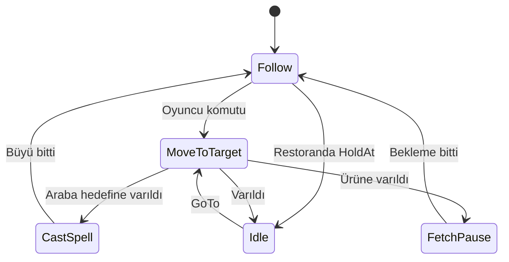
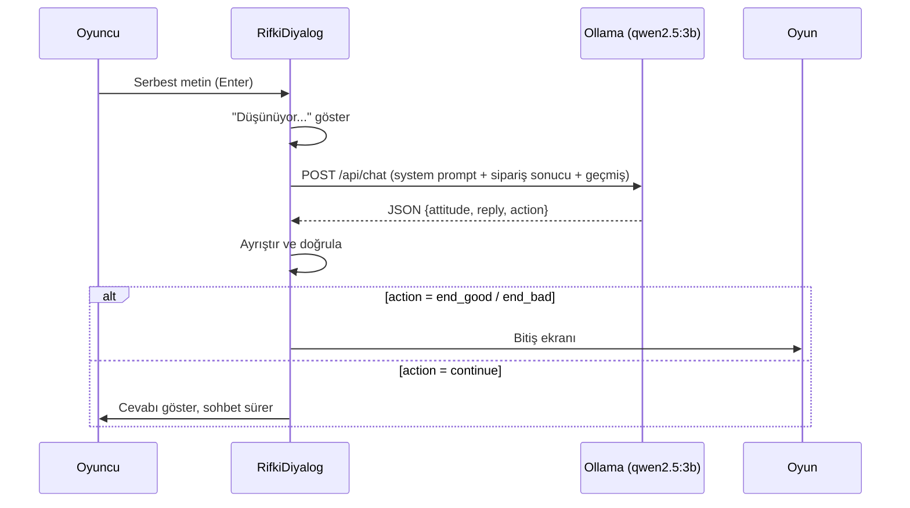

# Proje_oyun
# Midiş Pizza

**Yazılım Geliştirme Laboratuvarı-I, Proje-1** · Kocaeli Üniversitesi, Bilişim Sistemleri Mühendisliği
**Ekip:** nisanrcap, bltMelike · **Tarih:** Kasım 2026
**Motor:** Unity 6.3 LTS (6000.3.25f1), 2D · **Yerel LLM:** Ollama + qwen2.5:3b

---

## 1. Giriş

### 1.1 Problem ve amaç
Proje, bir Unity macera oyununda iki bağımsız yapay zekâ bileşenini birleştirir:
1. **NavMesh tabanlı otonom hayalet** (companion): oyuncuyu takip eder, engelleri aşar, garsonluk yapar.
2. **Yerel LLM ile çalışan NPC'ler**: oyuncu ve karakterler serbest metinle konuşur, model JSON döndürür, oyun durumu bu JSON'a göre değişir.

### 1.2 Senaryo
(Kendi cümlelerinle 4-5 cümle yaz.) Kız, otobüsten Midiş Döner'i görüp pizza yapmayı hayal eder. Dönerci Rıfkı Amca ölür ve hayalet olarak kıza dükkânı devreder. Oyuncu hayaletle araba engelini aşar, bekçi Hasan'ı ikna eder, marketten malzeme toplar, restoranda pizza yapıp hayalet garsonla müşteriye servis eder. Final: Rıfkı Amca'ya dükkânı beğenip beğenmediği sorulur, cevaba göre oyun biter.

### 1.3 Oyun akışı
Ana Menü → Sinematik → Sokak → Sahne2 (araba engeli + bekçi Hasan) → Market → Restoran → Final (Rıfkı Amca)

### 1.4 Kurulum
1. Unity Hub ile **6000.3.25f1** kur.
2. `git clone https://github.com/bltMelike/Proje_oyun.git`
3. Ollama kur (https://ollama.com), `ollama pull qwen2.5:3b`, `http://localhost:11434` açık olsun.
4. `AnaMenu` sahnesinden başlat. Sahne sırası: AnaMenu, Sinematik, SampleScene, Sahne2, market, restoran.

### 1.5 Kontroller
| Tuş | İşlev |
|---|---|
| WASD / Oklar | Yürüme |
| E | Tezgâhta pizza seç, NPC ile etkileşim |
| Fare tıklaması | Pizzayı fırına koy / hayalete nesne göster |
| H / ? | Yönerge paneli |
| Esc | Menü / geri |
| Enter | Sohbette mesaj gönder |

---

## 2. Otonom Hayalet (NavMesh)

- **NavMeshPlus + NavMeshAgent** ile gerçek yol bulma. Engeller `Not Walkable` ile işaretlendi.
- **Raycast sensörü** hayaletin önündeki engeli algılar. *(Doldur: ray uzunluğu, layer, hangi durumda çalışır.)*
- Karar mantığı **durum makinesi** (State Pattern).

---

## 3. LLM Mimarisi

### 3.1 NPC'ler
| NPC | Görev | JSON şeması |
|---|---|---|
| Hasan (bekçi) | Market kapısını açar | `{attitude, reply, action}` |
| Müşteri | Sipariş seçer, teşekkür/itiraz eder | `{reply, pizza}` |
| Hayalet garson | Menü sunar, siparişi iletir | `{reply}` |
| **Rıfkı Amca (final)** | Dükkân hakkında cevap verir, oyunu bitirir | `{attitude, reply, action}` |

### 3.2 İstek/yanıt akışı (Rıfkı Amca)

### 3.3 Sistem promptları
*(Dosyalardaki güncel metinleri yapıştır: Hasan → `NpcDialogue.cs`, Müşteri/Garson → `WaiterFlow.cs`, Amca → `RifkiDiyalog.cs`.)*

**Rıfkı Amca:** Sipariş sonucu (doğru/yanlış pizza) koddan bağlam olarak verilir, cevabı ve kararı model üretir. Örnek diyaloglar prompt içindedir.

### 3.4 Model seçimi
llama3.2:3b ve gemma2:2b denendi (Türkçe/kalite yetersiz), 7B modeller CPU'da ~25 sn ile çok yavaş. **qwen2.5:3b** ~5-20 sn ile dengeli.

### 3.5 Kod tarafı güvenlik önlemleri
- `NpcDecisionGuard`: uygunsuz mesajda LLM yanlış karar verse bile geçişi engeller.
- Müşteri cevabından rol dışı ifadeler temizlenir.
- Sipariş ile getirilen pizza kodla karşılaştırılır, sonuç LLM'e bağlam olur.
- Final sohbeti 4 turda sonlanır (sonsuz döngü önlemi).

---

## 4. Hata Yönetimi

| Durum | Davranış |
|---|---|
| Ollama kapalı | "Yapay zekâ sunucusuna ulaşılamadı. Ollama açık mı?" |
| Model yüklü değil (404) | "Sunucu hatası (404). Model yüklü mü?" |
| Zaman aşımı | Hata mesajı, tekrar denenebilir |
| Geçersiz JSON | Mesaj gösterilir / bir kez otomatik yeniden dene |
| Boş yanıt | Hata mesajı |

İstekler `Awaitable` ile kare kare beklenir, oyun donmaz. NPC adına cevap uydurulmaz.

---

## 5. Oyunun Diğer Sistemleri

| Sistem | Açıklama |
|---|---|
| Sinematik | 5 karelik flashback, daktilo efektli yazı, tıkla-ilerle |
| Araba olayı | Kontrol kilitlenir, araba gelir, kız korkar, kontrol geri gelir |
| Pizza sistemi | `Pizza` (durum: Ham, Pişiyor, Hazır, Alındı), `Firin`, `PizzaTezgahi`, `PizzaSecimPaneli` |
| Müşteri | `Musteri`, `OturmaNoktasi`: boş koltuğu seçip oturur |
| Final | `RifkiAmca`, `PufEfekti`, `RifkiDiyalog`, `FinalBaglayici` |
| Arayüz | `AnaMenu`, `EkranGecisi`, `YonergePaneli`, `HintBar` |

### OOP / SOLID
| Sınıf | Sorumluluk |
|---|---|
| `Pizza` | Kendi durumunu yönetir |
| `Firin` | Pişirme süreci |
| `PizzaTezgahi` | Üretim ve seçim |
| `OyunKilidi` | Diyalog sırasında kısayolları kilitler |
| `GhostStateMachine`, `IGhostState` | State Pattern |
| `ILlmClient`, `OllamaClient` | LLM bağımlılığı arayüz arkasında (D) |

*(Kendi gözlemlerini ekle: S, O, D örnekleri.)*

---

## 6. Test Sonuçları

### 6.1 Hasan diyalog testleri (en az 5 senaryo)
| # | Oyuncu mesajı | Beklenen | Gelen (attitude / action) | Geçti |
|---|---|---|---|---|
| 1 | Kibar + sebep | step_aside | | |
| 2 | Kaba emir | stay | | |
| 3 | Hakaret | stay | | |
| 4 | Alakasız | stay | | |
| 5 | Manipülasyon | stay | | |
| 6 | Ollama kapalı | Sistem hata mesajı | | |

### 6.2 Rıfkı Amca final testleri
| # | Durum | Oyuncu mesajı | Beklenen | Gelen | Geçti |
|---|---|---|---|---|---|
| 1 | Doğru pizza | "Restoranı beğendin mi?" | end_good | | |
| 2 | Yanlış pizza | "Restoranı beğendin mi?" | end_bad | | |
| 3 | Her ikisi | "Hava nasıl?" | continue | | |
| 4 | Her ikisi | Hakaret | continue / kırgın | | |

### 6.3 Hayalet navigasyon testi
| Başlangıç | Hedef | Deneme | Başarılı | Ort. süre (sn) |
|---|---|---|---|---|
| | | | | |

Başarı oranı: …/… (%…)

---

## 7. Ekran Görüntüleri
Ana menü, sinematik, araba olayı, Hasan sohbeti, "Düşünüyor...", hata mesajı, market, restoran, pizza seçimi, final diyaloğu, iki bitiş ekranı.

---

## 8. Sonuç ve Tartışma
**Başarılar:** gerçek NavMesh yol bulma, tamamen yerel LLM, JSON ile oyun durumu tetikleme, çökmeyen hata yönetimi.
**Sınırlılıklar:** 3B model bazen rolünden çıkar, CPU'da 5-20 sn gecikme, Türkçe akıcılık sınırlı.
**Geliştirmeler:** daha büyük model, ses, daha fazla müşteri ve sipariş çeşidi, kayıt sistemi.

---

## 9. Ekip ve Katkılar
| Üye | Sorumluluk |
|---|---|
| nisanrcap | Hayalet yapay zekâsı, LLM NPC'ler, sahne entegrasyonu |
| bltMelike | Sahneler, oyuncu, animasyon, pizza sistemi, müşteri, sinematik, menü, final |

*(Commit dağılımı eşit olmalı, doğrula.)*

## 10. Kullanılan Varlıklar
Görseller Gemini ile üretildi. Model: qwen2.5:3b (Alibaba, Ollama üzerinden yerel).

